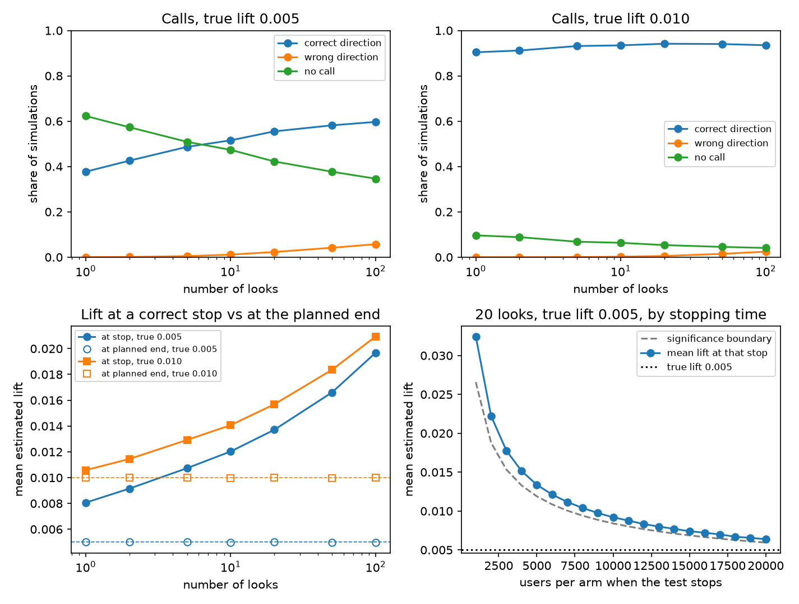
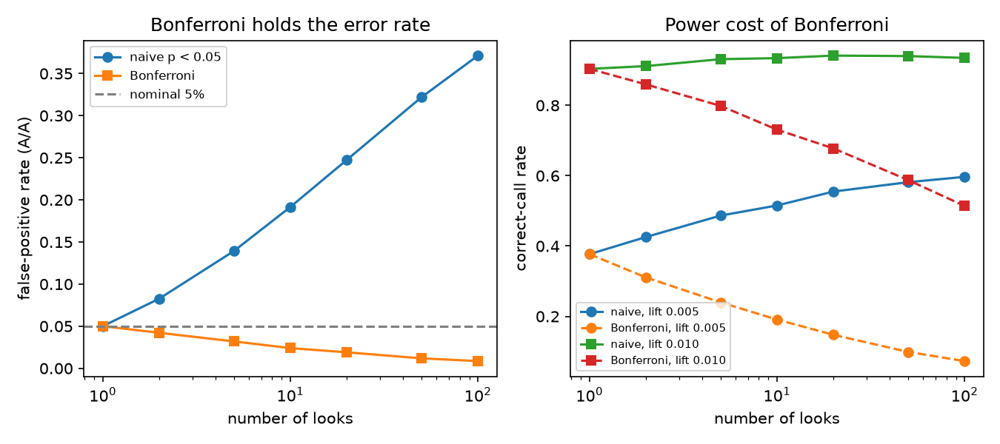

# peeking-problem

**If you check an A/B test every day and stop as soon as it looks significant, how often are you fooled — and which fix gives the best trade-off?**

Everyone says "don't peek". This repo puts numbers on it with simulation, then tests the standard remedies (alpha spending, mSPRT / always-valid p-values, Bayesian stopping) on the same footing: false-positive rate, power, and how many users each one costs.

## Findings so far

### 01 · Naive peeking (A/A tests, no true effect)

Fixed total sample of 20,000 users per arm at a 10% base conversion rate, split into equal batches. After each batch we run a two-proportion z-test and stop at the first p < 0.05. 20,000 simulations per point.

| Looks | False-positive rate |
|------:|--------------------:|
| 1 | 5.0% |
| 2 | 8.5% |
| 5 | 14.1% |
| 10 | 19.7% |
| 20 | 24.4% |
| 50 | 32.2% |
| 100 | 37.1% |


Checking daily for a month turns a 5% error rate into roughly 1-in-4. These values match the classical calculation of Armitage, McPherson & Rowe (1969), which the test suite checks against.

### 02 · Real effect: the call and the lift at the first significant look

Same design as the A/A runs. 20,000 users per arm, control conversion 10%, equal batches, two-sided z-test, stop at the first p < 0.05. 20,000 simulations. Treatment converts at 10.5% or 11%, so the true lifts are 0.005 and 0.010.

A correct call is a first significant result with the same sign as the true lift. "Lift at a right call" averages the estimated lift over those simulations only. "At the planned end" averages the estimate that uses all 20,000 users, including simulations that would have stopped early. "At decision" is the estimate at the stopping look, or the planned-end estimate when the test never crosses 0.05.

One look matches the truncated-normal formula. For a true lift of 0.005 the formula gives a correct-call probability of 0.3777 and a mean lift of 0.00805 given a correct call; the simulation gives 0.3769 and 0.00806. For a true lift of 0.010 the formula gives 0.9036 and 0.01058; the simulation gives 0.9039 and 0.01058.

True lift 0.005:

| Looks | Correct | Wrong | No call | Lift at a right call | At decision | At the planned end | Mean users |
|------:|--------:|------:|--------:|---------------------:|------------:|-------------------:|-----------:|
| 1 | 37.69% | 0.01% | 62.30% | 0.00806 | 0.00501 | 0.00501 | 20000.0 |
| 2 | 42.56% | 0.11% | 57.33% | 0.00915 | 0.00564 | 0.00502 | 17861.0 |
| 5 | 48.65% | 0.46% | 50.89% | 0.01073 | 0.00664 | 0.00502 | 15693.4 |
| 10 | 51.53% | 1.12% | 47.34% | 0.01203 | 0.00731 | 0.00498 | 14487.5 |
| 20 | 55.50% | 2.28% | 42.22% | 0.01371 | 0.00823 | 0.00501 | 13213.5 |
| 50 | 58.16% | 4.15% | 37.69% | 0.01660 | 0.00926 | 0.00497 | 11905.1 |
| 100 | 59.68% | 5.70% | 34.62% | 0.01968 | 0.01032 | 0.00498 | 11006.8 |

With 100 looks, a right call puts the 0.005 lift at 0.01968. The planned-end average stays at 0.00498. Folding the inconclusive runs back in, the decision-time estimate is still 0.01032. Mean sample size falls from 20000.0 to 11006.8 users per arm. Wrong-direction calls rise from 0.01% to 5.70%.

True lift 0.010:

| Looks | Correct | Wrong | No call | Lift at a right call | At decision | At the planned end | Mean users |
|------:|--------:|------:|--------:|---------------------:|------------:|-------------------:|-----------:|
| 1 | 90.39% | 0.00% | 9.61% | 0.01058 | 0.01000 | 0.01000 | 20000.0 |
| 2 | 91.17% | 0.00% | 8.83% | 0.01144 | 0.01084 | 0.01002 | 13652.5 |
| 5 | 93.14% | 0.05% | 6.81% | 0.01292 | 0.01232 | 0.01002 | 9886.4 |
| 10 | 93.44% | 0.22% | 6.34% | 0.01407 | 0.01337 | 0.00998 | 8506.3 |
| 20 | 94.15% | 0.53% | 5.32% | 0.01568 | 0.01485 | 0.01001 | 7364.8 |
| 50 | 94.02% | 1.46% | 4.52% | 0.01836 | 0.01686 | 0.00997 | 6378.6 |
| 100 | 93.49% | 2.44% | 4.06% | 0.02094 | 0.01850 | 0.00998 | 5768.4 |

One look already calls this lift in the right direction 90.39% of the time, and the conditional estimate is 0.01058. More looks do not keep raising the correct-call rate: it is 94.15% at 20 looks and 93.49% at 100, while wrong-direction calls go from 0.53% to 2.44%. The stopped estimate still rises, to 0.02094. The planned-end average stays at 0.00998. Mean sample size falls to 5768.4 users per arm.

The early stops carry the exaggeration. With 20 looks and a true lift of 0.005, the 1136 simulations that first cross on the correct side at 1000 users per arm average an estimate of 0.03245. The significance boundary at that sample size is 0.02659. The 329 simulations that first cross at the planned end average 0.00637, against a boundary of 0.00594. For a true lift of 0.010 the first-look mean is 0.03353, against a boundary of 0.02687 (2150 correct stops).



### 03 · Bonferroni across looks

Same batching as before: 20,000 users per arm, 10% control rate, two-sided z-test, stop at the first look that crosses the threshold. Naive peeking uses p < 0.05 at every look. Bonferroni uses p < 0.05 / K at look K of K planned looks (union bound: overall false-positive rate ≤ 5%). 20,000 A/A simulations per point.

| Looks | Naive FPR | Bonferroni FPR |
|------:|----------:|---------------:|
| 1 | 5.0% | 5.0% |
| 2 | 8.3% | 4.2% |
| 5 | 13.9% | 3.2% |
| 10 | 19.2% | 2.4% |
| 20 | 24.8% | 1.9% |
| 50 | 32.2% | 1.2% |
| 100 | 37.1% | 0.9% |

Bonferroni keeps the A/A error rate at or below 5% at every peek count; it is conservative (0.9% at 100 looks). Power is the share of simulations with a first significant result in the true direction (same lifts 0.005 and 0.010 as experiment 02).

True lift 0.005:

| Looks | Naive correct | Bonferroni correct | Naive no call | Bonferroni no call |
|------:|--------------:|-------------------:|--------------:|-------------------:|
| 1 | 37.69% | 37.69% | 62.30% | 62.30% |
| 10 | 51.53% | 19.08% | 47.34% | 80.83% |
| 100 | 59.68% | 7.28% | 34.62% | 92.64% |

True lift 0.010:

| Looks | Naive correct | Bonferroni correct | Naive no call | Bonferroni no call |
|------:|--------------:|-------------------:|--------------:|-------------------:|
| 1 | 90.39% | 90.39% | 9.61% | 9.61% |
| 10 | 93.44% | 73.10% | 6.34% | 26.88% |
| 100 | 93.49% | 51.40% | 4.06% | 48.59% |

With 100 daily looks and a 0.010 lift, naive peeking calls the winner correctly 93.5% of the time; Bonferroni drops that to 51.4% and leaves almost half of runs inconclusive. The fix is honest about error control but expensive in power.



## Layout

- `src/peeking/` — simulation and stopping-rule code
- `scripts/` — one script per experiment, writes to `results/`
- `tests/` — pytest suite; every experiment's core logic is tested
- `ROADMAP.md` — what's next
- `LOG.md` — dated research log

## Run it

```bash
pip install -e ".[dev]"
pytest
python scripts/01_naive_peeking.py
python scripts/02_winner_curse.py
python scripts/03_bonferroni.py
```

## License

MIT
