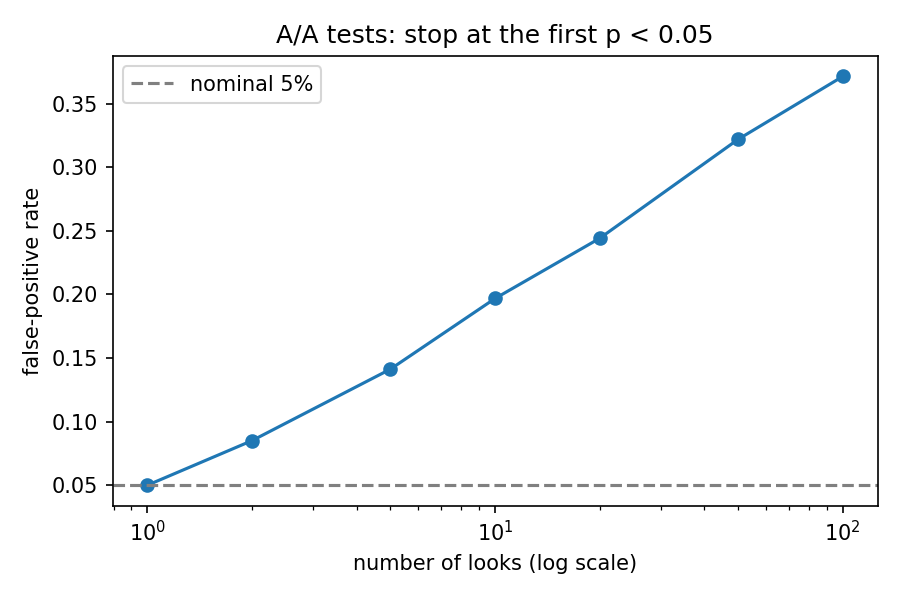

# peeking-problem

**If you check an A/B test every day and stop as soon as it looks significant, how often are you fooled — and which fix gives the best trade-off?**

Everyone says "don't peek". This repo puts numbers on it with simulation, then tests the standard remedies (alpha spending, mSPRT / always-valid p-values, Bayesian stopping) on the same footing: false-positive rate, power, and how many users each one costs.

## Findings so far

### 01 · Naive peeking (A/A tests, no true effect)

Fixed total sample of 20,000 users per arm at a 10% base conversion rate, split into equal batches. After each batch we run a two-proportion z-test and stop at the first p < 0.05. 20,000 simulations per point.

| Looks | False-positive rate |
|------:|--------------------:|
| 1 | 5.0% |
| 2 | 8.5% |
| 5 | 14.1% |
| 10 | 19.7% |
| 20 | 24.4% |
| 50 | 32.2% |
| 100 | 37.1% |



Checking daily for a month turns a 5% error rate into roughly 1-in-4. These values match the classical calculation of Armitage, McPherson & Rowe (1969), which the test suite checks against.

## Layout

- `src/peeking/` — simulation and stopping-rule code
- `scripts/` — one script per experiment, writes to `results/`
- `tests/` — pytest suite; every experiment's core logic is tested
- `ROADMAP.md` — what's next
- `LOG.md` — dated research log

## Run it

```bash
pip install -e ".[dev]"
pytest
python scripts/01_naive_peeking.py
```

## License

MIT
